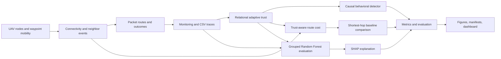
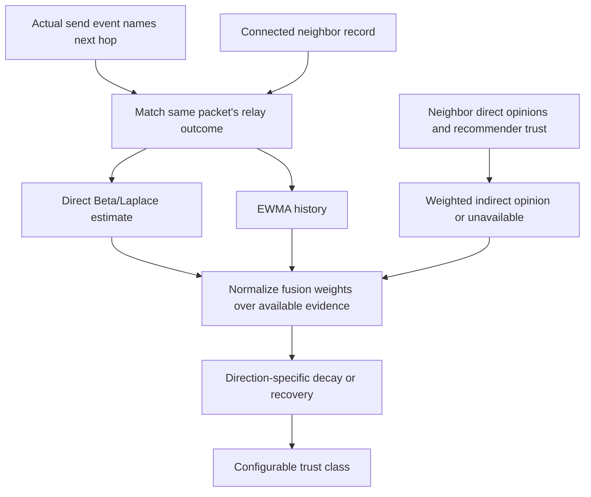
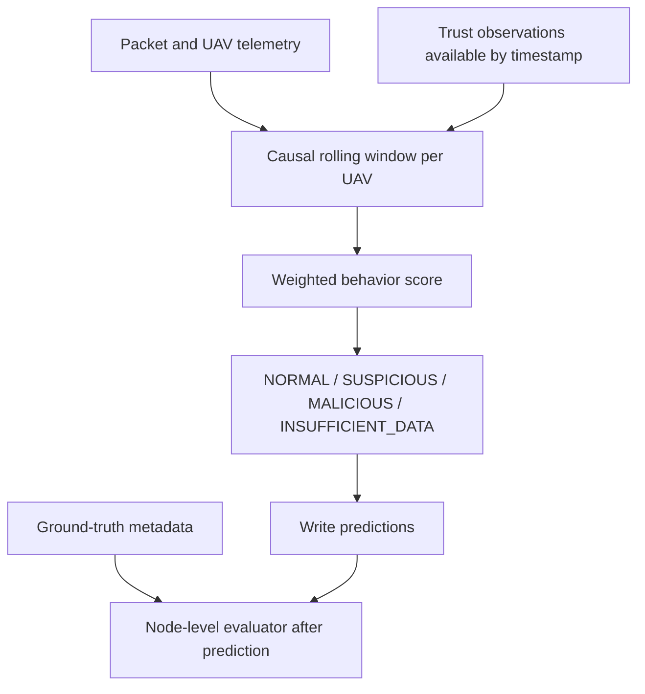
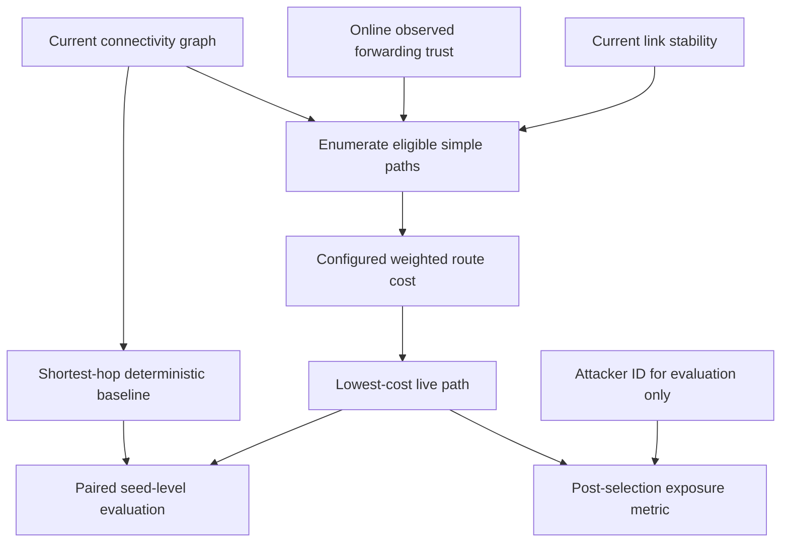
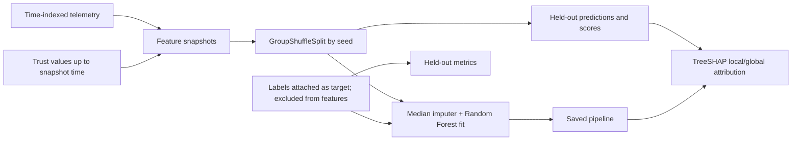
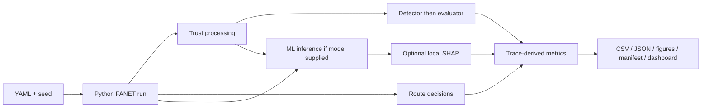

# AEX-TFANET architecture diagrams

All diagrams describe implemented behavior. The simulation box is the **Simplified Python FANET Model — NOT NS-3**.

## Overall architecture

## Trust computation flow

## Detection flow

## Routing flow

## ML and SHAP flow

## Complete experimental pipeline

